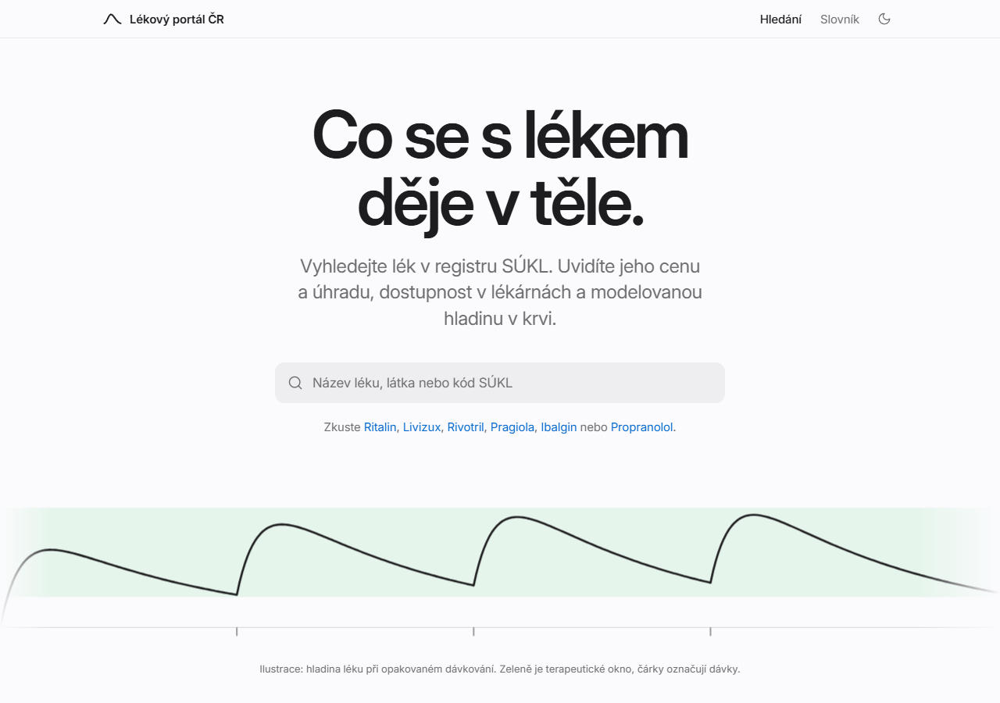
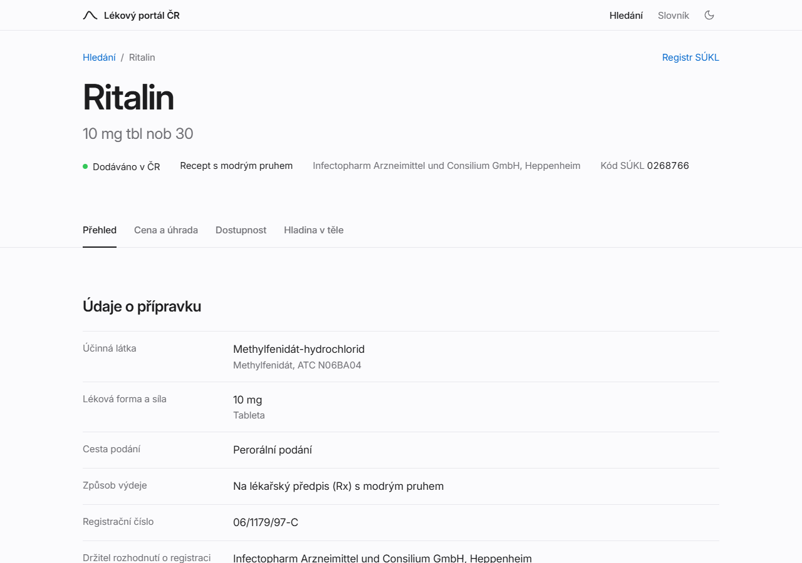
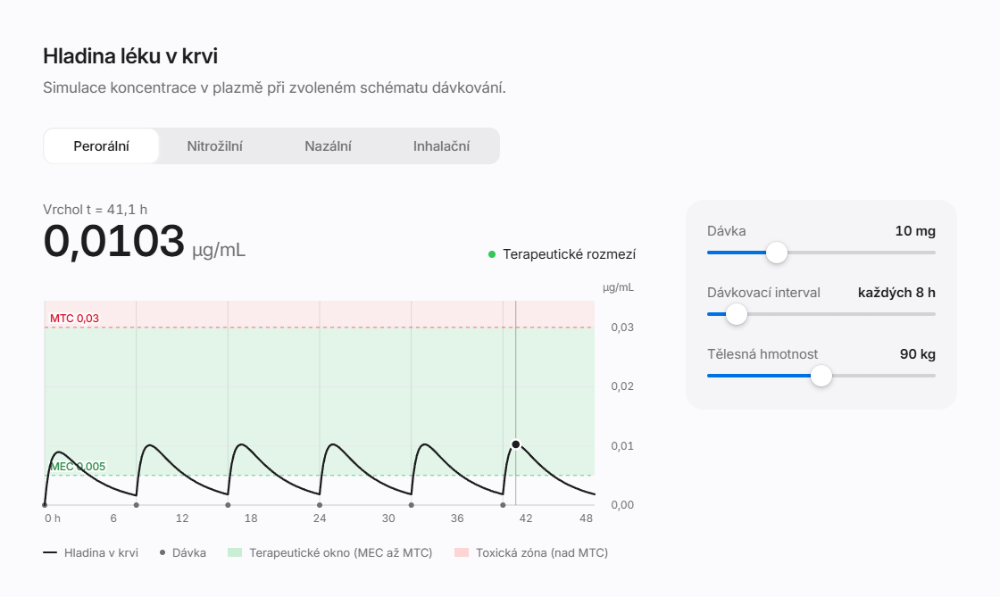
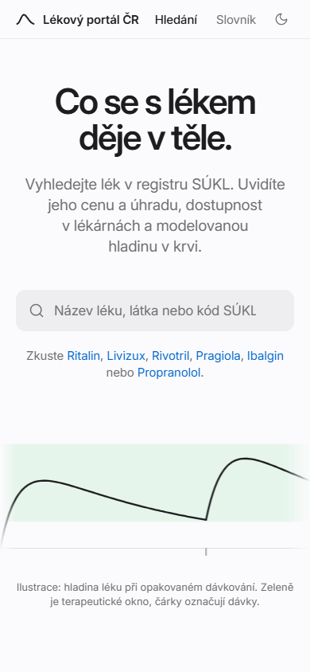
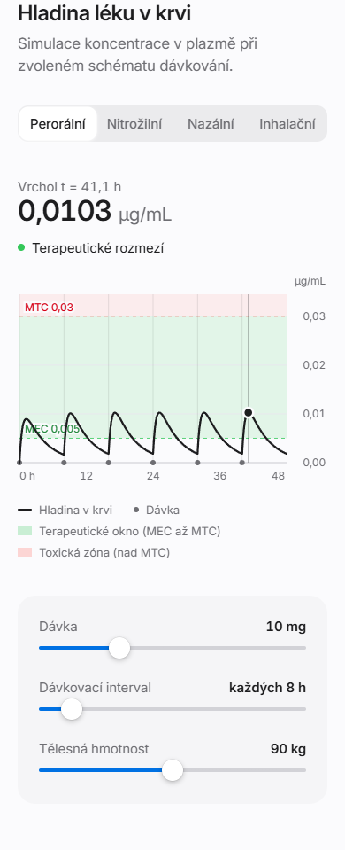

# Lékový portál ČR & Farmakokinetický simulátor

### Farmakokinetické modelování (PK/PD), TDM a kalkulačka Harm Reduction

[](https://www.python.org/)
[](https://nextjs.org/)
[](https://fastapi.tiangolo.com/)
[](https://streamlit.io/)
[](tests/)
[](LICENSE)

Otevřená platforma pro farmakokinetické simulace a lékový přehled postavená pro zdravotnické inženýry, farmakology, lékaře i edukaci pacientů. Systém implementuje exaktní jednokompartmentové farmakokinetické modely s perorální absorpcí (Batemanova funkce), nitrožilním bolusem (IV), intranazálním (šňupání) a inhalačním (kouření) podáním, analýzu kumulace v ustáleném stavu (*steady-state*), simulaci vynechané dávky (*missed dose*) a terapeutické monitorování hladin léčiv (TDM).

Aplikace je přímo napojena na otevřené databáze Státního ústavu pro kontrolu léčiv (SÚKL) pro zjišťování cen, úhrad zdravotních pojišťoven, hlášení o přerušení dodávek (výpadky dle § 33 zákona o léčivech) a kalkulačku ochranného limitu na doplatky.

> **Jazykové verze**: [English (README.md)](README.md) | Čeština

---

## Obsah

- [Náhled designu](#náhled-designu)
- [Jak projekt zprovoznit](#jak-projekt-zprovoznit)
  - [Možnost A: Kompletní stack přes Docker Compose (Doporučeno)](#moznost-a-kompletni-stack-pres-docker-compose-doporuceno)
  - [Možnost B: Lokální vývojové prostředí](#moznost-b-lokalni-vyvojove-prostredi)
- [Architektura a struktura projektu](#architektura-a-struktura-projektu)
- [Klíčové funkce systému](#klicove-funkce-systemu)
- [Vědecké a matematické základy](#vedecke-a-matematicke-zaklady)
  - [1. Perorální absorpce – Batemanova funkce](#1-peroralni-absorpce--batemanova-funkce)
  - [2. Nitrožilní bolus (IV)](#2-nitrozilni-bolus-iv)
  - [3. Opakované dávkování a ustálený stav (Steady-State)](#3-opakovane-davkovani-a-ustaleny-stav-steady-state)
  - [4. Plocha pod křivkou (AUC)](#4-plocha-pod-krivkou-auc)
- [Knihovna klinických léčiv](#knihovna-klinickych-leciv)
- [Testování a verifikace](#testovani-a-verifikace)
- [Zdravotnické upozornění](#zdravotnicke-upozorneni)
- [Licence](#licence)

---

## Náhled designu

Webový portál ([`frontend/`](frontend/)) má klidný design ve stylu Apple: velké písmo, tenké dělicí linky místo karet, jedna modrá barva a jediný výrazný prvek, křivka koncentrace. Je logem, čárou nakreslenou na úvodní stránce i interaktivním grafem na stránce každého léku. Světlý a tmavý motiv se řídí nastavením systému a rozložení funguje až po šířku telefonu.

<picture>
  <source media="(prefers-color-scheme: dark)" srcset="docs/preview/home-dark.png">
  
</picture>

<table>
  <tr>
    <td width="50%" valign="top">
      
      <br><sub><b>Stránka léku.</b> Údaje z registru jako prosté řádky a čtyři záložky: přehled, cena a úhrada, dostupnost, hladina v těle.</sub>
    </td>
    <td width="50%" valign="top">
      <picture>
        <source media="(prefers-color-scheme: dark)" srcset="docs/preview/kinetics-dark.png">
        
      </picture>
      <br><sub><b>Hladina v těle.</b> Tažením, dotykem nebo šipkami zjistíte koncentraci v libovolném čase.</sub>
    </td>
  </tr>
</table>

<p align="center">
  
  &nbsp;&nbsp;&nbsp;
  
</p>

<sub>Snímky ukazují celý stack (Next.js a FastAPI) pro balení Ritalin 10 mg.</sub>

**Kde design najdete**

- Barvy, typografie a rozestupy jsou CSS proměnné v [`frontend/app/globals.css`](frontend/app/globals.css), namapované v [`frontend/tailwind.config.ts`](frontend/tailwind.config.ts).
- Sdílené prvky rozhraní (Slider, Segmented, Tabs, Status, SpecList) jsou v [`frontend/components/ui/`](frontend/components/ui/).
- Typografie: SF Pro na zařízeních Apple, jinde přibalené písmo Inter Variable. České nezlomitelné mezery a desetinné čárky řeší [`frontend/lib/typo.ts`](frontend/lib/typo.ts) a [`frontend/lib/format.ts`](frontend/lib/format.ts).

---

## Jak projekt zprovoznit

### Možnost A: Kompletní stack přes Docker Compose (Doporučeno)

Nejrychlejší způsob spuštění celého produkčního prostředí (Next.js webový portál, FastAPI REST backend a Streamlit klinická laboratoř) jediným příkazem:

```bash
# 1. Klonování repozitáře
git clone https://github.com/sidd-1337/druglevelmodelingapp.git
cd druglevelmodelingapp

# 2. Sestavení a spuštění všech kontejnerů na pozadí
docker compose up -d --build
```

#### Přehled běžících služeb:

* **Webový portál (Next.js 15, klidný design ve stylu Apple, viz [Náhled designu](#náhled-designu))**: [http://localhost:3000](http://localhost:3000)
  * Okamžité vyhledávání léků v SÚKL, stažení SPC/PIL v PDF, kalkulačka cen a ochranného limitu na doplatky, výpadky na trhu, reaktivní křivky a kalkulačka Harm Reduction.
* **REST API backend (FastAPI)**: [http://localhost:8000](http://localhost:8000)
  * Interaktivní dokumentace OpenAPI Swagger dostupná na [http://localhost:8000/docs](http://localhost:8000/docs).
* **Klinická laboratoř (Streamlit)**: [http://localhost:8501](http://localhost:8501)
  * Expertní simulátor: modelování vynechané dávky (*missed dose*), semilogaritmické osy, populační variační pásma eliminace a exporty do CSV. Světlý a tmavý (noční) motiv se řídí nastavením systému, ručně jde přepnout v menu aplikace (⋮ → Settings).

Pro zastavení kontejnerů:

```bash
docker compose down
```

---

### Možnost B: Lokální vývojové prostředí

#### 1. Zprovoznění Python backendu a jádra

```bash
# Vytvoření a aktivace virtuálního prostředí
# Linux / macOS:
python3 -m venv .venv
source .venv/bin/activate

# Windows (PowerShell):
python -m venv .venv
.\.venv\Scripts\Activate.ps1

# Instalace závislostí
pip install -r requirements.txt

# Spuštění FastAPI backendu (port 8000)
uvicorn backend.app.main:app --host 0.0.0.0 --port 8000 --reload

# V samostatném terminálu: Spuštění Streamlit laboratoře (port 8501)
streamlit run app.py
```

#### 2. Zprovoznění Next.js frontendu

```bash
cd frontend
npm install
npm run dev
```

Aplikace bude dostupná na adrese [http://localhost:3000](http://localhost:3000).

---

## Architektura a struktura projektu

Projekt využívá čistou oddělenou architekturu, kde jsou matematické výpočty nezávislé na prezentační vrstvě:

```
druglevelmodelingapp/
├── backend/                    # FastAPI REST API služba
│   ├── app/
│   │   ├── main.py             # Vstupní bod, správa CORS
│   │   ├── routers/            # Endpointy pro léky a simulace (/drugs, /pk)
│   │   └── schemas/            # Pydantic v2 datové modely
│   └── tests/                  # Integrační testy REST API
├── core/                       # Čisté matematické a farmakologické jádro
│   ├── pk_engine.py            # Batemanova funkce, IV bolus, superpozice, AUC, ustálený stav
│   ├── harm_reduction.py       # Výpočet bezpečných odstupů, vrstvení dávek, časové fáze
│   ├── drug_database.py        # Správa presetů, validace a továrna modelů
│   ├── metrics.py              # Klinické metriky, TDM klasifikace, obnova profilu
│   └── sukl_client.py          # Klient pro otevřené REST API SÚKL a mapování ATC
├── frontend/                   # Produkční Next.js 15 portál (klidný design ve stylu Apple, viz Náhled designu)
│   ├── app/                    # App Router: /, /leky/[kod], /slovnik
│   ├── components/             # Prvky ui/, HeroCurve, PkChart (SVG), CopayCalculator, ThemeToggle
│   └── lib/                    # Klientské API, PK výpočetní jádro, SÚKL cache, české formátování
├── ui/                         # Streamlit prezentační vrstva
│   ├── charts.py               # Vykreslování interaktivních Plotly grafů s TDM zónami
│   ├── reporting.py            # Generování dávkovacích protokolů a export do CSV
│   └── i18n.py                 # Lokalizace rozhraní (čeština, angličtina)
├── data/
│   └── drugs.json              # Validované klinické farmakokinetické presety
├── tests/                      # Sada 109 automatizovaných testů
├── docker-compose.yml          # Konfigurace vícekontejnerového prostředí
├── Dockerfile                  # Kontejner pro Streamlit
├── Dockerfile.backend          # Kontejner pro FastAPI
└── README.md                   # Dokumentace v angličtině
```

---

## Klíčové funkce systému


| Funkce                                 | Popis                                                                                                                                                                             |
| :------------------------------------- | :-------------------------------------------------------------------------------------------------------------------------------------------------------------------------------- |
| **Přesné PK jádro**                 | Batemanův 1-kompartmentový model, IV bolus a numerická validace proti ODE řešičům.                                                                                         |
| **Čtyři cesty podání**             | Perorální ($p.o.$), nitrožilní bolus ($i.v.$), intranazální (šňupání) a inhalační (kouření).                                                                        |
| **Ustálený stav (Steady-State)**     | Výpočet$C_{ss,\max}$, $C_{ss,\min}$, $C_{ss,\text{avg}}$, akumulačního faktoru $R$ a fluktuace mezi dávkami.                                                                 |
| **Terapeutické monitorování (TDM)** | Okamžitá klasifikace koncentrace:**Toxická zóna** ($> \text{MTC}$), **Terapeutické okno** ($\text{MEC}\text{--}\text{MTC}$) a **Subterapeutická hladina** ($< \text{MEC}$). |
| **Harm Reduction kalkulačka**         | Odpočet bezpečného odstupu do další dávky, prevence toxického vrstvení a odhad časových fází účinku.                                                                |
| **Simulace vynechané dávky**         | Vyhodnocení dopadu opožděného či vynechaného užití dávky a doba návratu do cílového profilu.                                                                          |
| **Populační rozptyl**                | Pásmo spolehlivosti zohledňující interindividuální rozdíly v poločase eliminace$t_{1/2}$.                                                                                 |
| **Integrace otevřených dat SÚKL**   | Živé dotazování do databáze SÚKL: automatické načtení síly léku, SPC/PIL příbalových letáků, hlášení výpadků dle § 33 a režimů úhrad.                    |
| **Kalkulačka ochranného limitu**     | Výpočet čerpání zákonného ročního limitu na započitatelné doplatky (5 000 / 1 000 / 500 Kč).                                                                          |
| **Čistý design**                     | Klidné rozhraní ve stylu Apple se světlým i tmavým motivem (automatická detekce systému, bez problikávání), písmem SF Pro / Inter, ovládáním z klávesnice a rozložením až po šířku telefonu. |

---

## Vědecké a matematické základy

Matematické jádro (`core/pk_engine.py`) modeluje osud léčiva pomocí lineární jednokompartmentové farmakokinetiky.

### 1. Perorální absorpce – Batemanova funkce

Pro extravaskulární (perorální) podání s absorpcí a eliminací prvního řádu:

$$
C(t) = \frac{F \cdot D \cdot k_a}{V_d \, (k_a - k_e)} \left( e^{-k_e t} - e^{-k_a t} \right)
$$

Kde:

* $D$ = Podaná dávka ($\text{mg}$)
* $F$ = Biologická dostupnost ($0 < F \le 1$)
* $k_a$ = Absorpční rychlostní konstanta ($\text{h}^{-1}$)
* $k_e$ = Eliminační rychlostní konstanta ($\text{h}^{-1}$), odvozená z poločasu eliminace: $k_e = \frac{\ln 2}{t_{1/2}}$
* $V_d$ = Distribuční objem ($\text{L}$ nebo $\text{L/kg} \times \text{hmotnost}$)

#### Spojitost při flip-flop kinetice

V případě, kdy $k_a \to k_e$, využívá jádro spojitou limitní hodnotu pro zamezení numerické nestabilitě:

$$
\lim_{k_a \to k_e} C(t) = \frac{F \cdot D \cdot k_a}{V_d} \cdot t \cdot e^{-k_e t}
$$

A čas dosažení maximální koncentrace ($T_{\max}$):

$$
T_{\max} = \frac{\ln(k_a / k_e)}{k_a - k_e}, \quad \lim_{k_a \to k_e} T_{\max} = \frac{1}{k_e}
$$

### 2. Nitrožilní bolus (IV)

Okamžitý vstup do systémového oběhu bez absorpční fáze ($F = 1$, $k_a \to \infty$):

$$
C_{IV}(t) = \frac{D}{V_d} \, e^{-k_e t}, \quad T_{\max} = 0
$$

### 3. Opakované dávkování a ustálený stav (Steady-State)

Pravidelné podávání v dávkovacím intervalu $\tau$ vede ke kumulaci léčiva, dokud se eliminované množství nevyrovná podané dávce:

* **Akumulační faktor ($R$)**:

  $$
  R = \frac{1}{1 - e^{-k_e \tau}}
  $$
* **Koncentrace v ustáleném stavu ($C_{ss,\min}$ a $C_{ss,\max}$)**:

  $$
  C_{ss,\min} = C(t = \tau) \quad \text{v ustáleném stavu}
  $$
* **Průměrná koncentrace ($C_{ss,\text{avg}}$)**:

  $$
  C_{ss,\text{avg}} = \frac{F \cdot D}{CL \cdot \tau} = \frac{\text{AUC}_{\tau}}{ \tau}
  $$

  Kde celková clearance je $CL = k_e \cdot V_d$.
* **Doba do ustáleného stavu**: Dosažena za $4\text{--}5 \times t_{1/2}$ ($\approx 93.75\%\text{--}96.88\%$ rovnováhy).

### 4. Plocha pod křivkou (AUC)

Počítána lineární lichoběžníkovou metodou:

$$
\text{AUC}_{t_1 - t_2} = \sum_{i=1}^{N-1} \frac{C_i + C_{i+1}}{2} (t_{i+1} - t_i)
$$

---

## Knihovna klinických léčiv

Aplikace obsahuje přednastavené parametry v [`data/drugs.json`](data/drugs.json). Hodnoty popisují dospělého (70 kg) s normální funkcí ledvin; $V_d$ a $k_a$ jsou nafitovány tak, aby AUC / ustálená hladina, Cmax a Tmax odpovídaly publikovaným datům v [`data/reference_pk.json`](data/reference_pk.json) (kontrola: `python -m core.validation`). Každý preset nese i variabilitu clearance (a biologické dostupnosti) mezi pacienty, podíl renální eliminace, dvoukompartmentovou distribuci a zpoždění absorpce tam, kde to publikovaná data podporují, volitelné lékové formy (propranolol s okamžitým vs. prodlouženým uvolňováním) a u MDMA mechanismem podmíněnou inaktivaci CYP2D6.


| Léčivo              | Klinická kategorie              | $t_{1/2}$ (h) | $V_d$ (L/kg) |    $F$    | $k_a$ (h⁻¹) |    MEC    |    MTC    |     Jednotka     | Klinický kontext                                                                |
| :-------------------- | :------------------------------- | :-----------: | :----------: | :--------: | :-----------: | :--------: | :--------: | :--------------: | :------------------------------------------------------------------------------- |
| **Ibuprofen**         | NSAID analgetikum                |     $2.0$     |    $0.13$    |   $0.90$   |    $2.40$    |   $10.0$   |   $50.0$   | $\mu\text{g/mL}$ | Rychlé vstřebávání; dávkování po 6–8 h.                                 |
| **Paracetamol**       | Analgetikum / antipyretikum      |     $2.5$     |    $0.70$    |   $0.80$   |    $3.80$    |   $10.0$   |   $30.0$   | $\mu\text{g/mL}$ | Široké bezpečné rozmezí; limit MTC hlídá toxický metabolit NAPQI.        |
| **Amoxicilin**        | Aminopenicilinové antibiotikum  |     $1.0$     |    $0.28$    |   $0.80$   |    $0.55$    |   $2.0$   |   $40.0$   | $\mu\text{g/mL}$ | Časově závislý účinek ($T > \text{MIC}$); rychlé vylučování ledvinami. |
| **Lithium**           | Stabilizátor nálady            |     $24.0$     |    $0.70$    |   $0.95$   |    $1.00$    |   $0.6$   |   $1.5$   | $\text{mmol/L}$ | **Úzké terapeutické okno (NTI)**: toxicita nad $1.5\,\text{mmol/L}$.          |
| **Diazepam**          | Dlouhodobý benzodiazepin        |     $40.0$     |    $1.20$    |   $0.93$   |    $4.00$    |   $0.2$   |   $0.8$   | $\mu\text{g/mL}$ | Výrazná akumulace při opakovaném užívání.                                |
| **Livizux**           | ADHD stimulans (lisdexamfetamin) |     $11.0$     |    $3.35$    |   $0.95$   |    $0.67$    |   $0.02$   |   $0.10$   | $\mu\text{g/mL}$ | Proléčivo d-amfetaminu; užívání 1× denně ráno. AGNP 20–80 ng/mL.       |
| **Levetiracetam**     | Antiepileptikum (Keppra)         |     $7.0$     |    $0.60$    |   $1.00$   |    $4.50$    |   $12.0$   |   $46.0$   | $\mu\text{g/mL}$ | Téměř 100% vstřebávání; referenční rozmezí AGNP 12–46 µg/mL.         |
| **Pregabalin**        | Antiepileptikum / anxiolytikum   |     $6.3$     |    $0.59$    |   $0.90$   |    $3.90$    |   $2.0$   |   $8.0$   | $\mu\text{g/mL}$ | Lineární renální clearance; nízká vazba na bílkoviny. AGNP 2–5 µg/mL.   |
| **Propranolol**       | Neselektivní beta-blokátor     |     $4.0$     |    $2.70$    |   $0.25$   |    $1.60$    |   $0.02$   |   $0.20$   | $\mu\text{g/mL}$ | Výrazný first-pass metabolismus v játrech ($F \approx 25\%$, CV expozice cca 50 %).                 |
| **Rivotril**          | Benzodiazepin (klonazepam)       |     $35.0$     |    $2.30$    |   $0.90$   |    $1.50$    |   $0.02$   |   $0.08$   | $\mu\text{g/mL}$ | Vysoká akumulace v ustáleném stavu; rozmezí AGNP 20–70 ng/mL.               |
| **Mirtazapin**        | Antidepresivum (NaSSA)           |     $26.0$     |    $10.50$    |   $0.50$   |    $1.00$    |   $0.03$   |   $0.15$   | $\mu\text{g/mL}$ | Užívání 1× denně večer; terapeutické okno AGNP 30–80 ng/mL.             |
| **Risperidon**        | Atypické antipsychotikum        |     $20.0$     |    $1.70$    |   $0.70$   |    $2.00$    |   $0.02$   |   $0.08$   | $\mu\text{g/mL}$ | Modelováno jako aktivní frakce (risperidon + 9-OH); cíl 20–60 ng/mL.         |
| **Ritalin**           | ADHD stimulans (methylfenidát)  |     $2.8$     |    $3.10$    |   $0.15$   |    $1.30$    |  $0.005$  |  $0.030$  | $\mu\text{g/mL}$ | Krátký poločas vyžaduje dávkování 2–3× denně ($\tau = 8\text{ h}$).    |
| **Vlastní léčivo** | Uživatelsky definované         |  *vlastní*  |  *vlastní*  | *vlastní* |  *vlastní*  | *vlastní* | *vlastní* |    *vlastní*    | Plně konfigurovatelné pro nové molekuly a laboratorní data.                  |

---

## Testování a verifikace

Testovací sada pokrývá matematické vzorce, porovnání s numerickými ODE řešiči, extrakci dat SÚKL i REST API v rámci 109 testů:

```bash
# Spuštění testovací sady
pytest -q
```

---

## Zdravotnické upozornění

> **DŮLEŽITÉ UPOZORNĚNÍ:**
> Tato aplikace slouží výhradně pro výukové, modelovací, výzkumné a harm reduction účely. **Nejedná se** o certifikovaný zdravotnický prostředek a software není určen k primárnímu stanovení diagnózy, řízení léčby ani k závaznému klinickému dávkování u pacientů. Reálné dávkování vždy vyžaduje odbornou konzultaci s ošetřujícím lékařem nebo klinickým farmaceutem a individuální posouzení stavu pacienta (renální funkce, jaterní funkce, lékové interakce).

---

## Licence

Tento projekt je licencován pod licencí [MIT](LICENSE).
